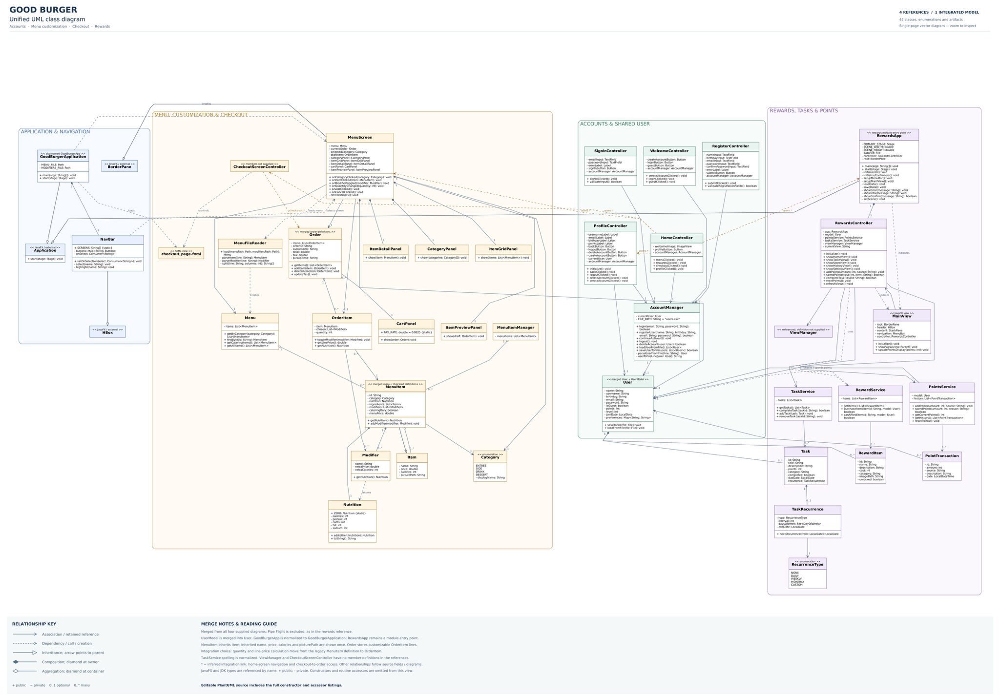
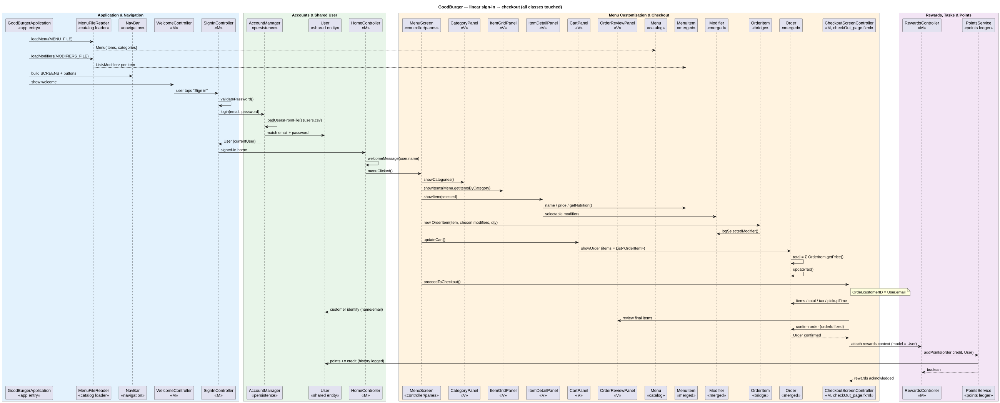
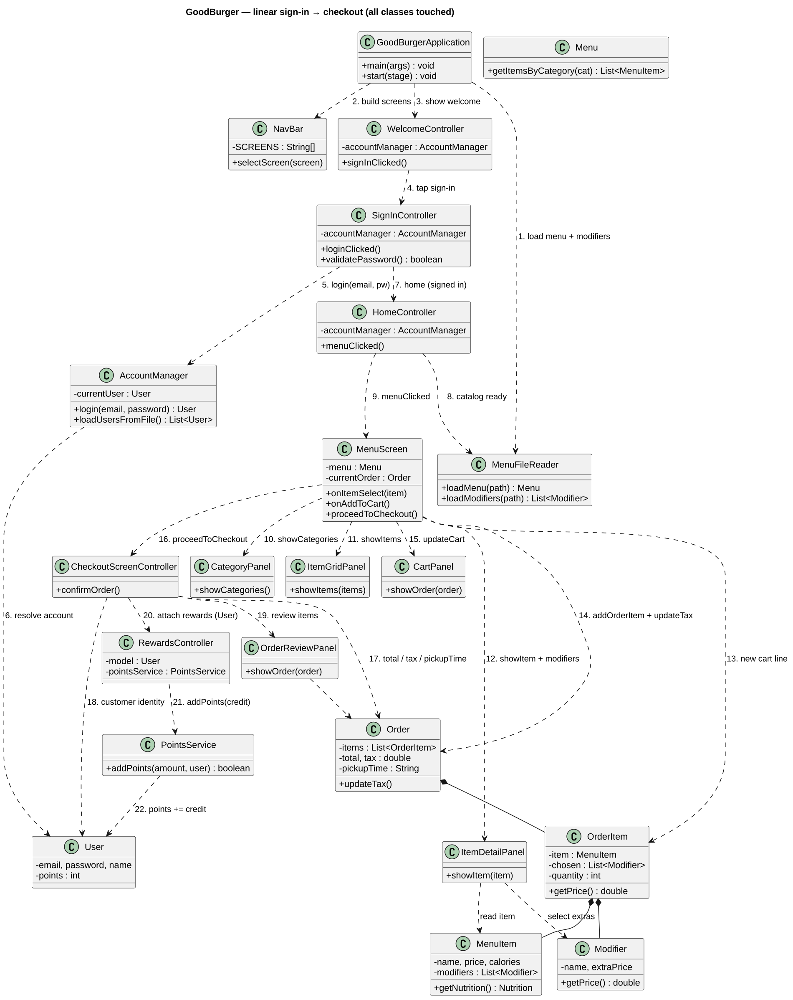

# GoodBurger (JavaFX)

GoodBurger is the ordering app (sign-in, menu, checkout, profile) plus a Rewards page with two mini games: **Pipe Flight**, a JavaFX Canvas game with noir city, ocean, and underwater stages (hazards and health; Power, Armor, and Recovery upgrades; audio; the final drowning scene), and **Poker**, a seven-card stud game played against the dealer. The menu screen lists every item with its original name, price, photo, and description, and the data managers parse full nutrition values (calories, protein, carbs, fat, and more) from `data/menu.csv` and `data/modifiers.csv`; item copy lives in `data/ItemDescriptions.txt`.

## Run

Maven project, JDK 21 or newer:

```bash
./build.sh    # mvn clean package
./test.sh     # compile and run the logic checks (rewards.LogicTest)
```

## Windows

Extract the entire ZIP and double-click `run-windows.bat`. The package includes the compiled app and Windows x64 JavaFX 21.0.6 libraries. It uses an installed 64-bit Java 21.

## Seven-card stud (Poker button)

Both sides are dealt seven cards: two stay hidden, five are shown one per street, and you bet, call, raise, or fold on each of six streets. The best five of the seven cards wins the pot at showdown. Shown ranks that match the dealer's push the pot. The hand runs on a 50-point ante against your rewards balance; the net win or loss is settled through `ProgressStore.adjustPoints`, and completing a winning showdown can claim the daily bonus. The first poker win earns the one-time Card Shark award of 200 points. The dealer follows a fixed strategy (check-raises strong hands, limps early junk, and folds junk by the third street) so every result is deterministic for a given deal.

## Rewards rules

- The starting balance is **500 points**.
- Each Pipe Flight play **spends 500 points**, including retries with R or Enter.
- Each pipe passed awards **1 rewards point** immediately. Poker coins remain a separate in-game score.
- Pipe Flight can award at most **2,000 rewards points per local calendar day**. The game button becomes unavailable after that cap is reached, and the cap resets on the next local day.
- Balance, daily earnings, and redemptions persist in `~/.local/share/rewards-javafx/progress.properties`. Game campaign progress and upgrades last only for the current app session, matching the Go game's restart behavior.

## Game controls

| Stage | Controls |
|---|---|
| Noir city | Tap W, Up, or Space to flap; hold S or Down to dive; A/D or Left/Right to steer. |
| Ocean | Hold W, Up, or Space to rise; release to fall slowly; S dives; A/D steers. |
| Underwater | W/S or Up/Down to swim vertically; A/D or Left/Right to steer. |

In poker, Enter or Space reveals and then continues. After a poker win, 1, 2, or 3 selects an upgrade. M toggles sound. Esc returns to rewards. After FAILED, R or Enter starts another paid play if the balance and daily cap allow it.

## UML

Class diagrams live in [`docs/UML/`](docs/UML/):

- `goodburger-full.png` — integrated model merging all source diagrams into one page: Application & Navigation, Menu Customization & Checkout, Accounts & Shared User, and Rewards/Tasks/Points (with a relationship legend).
- `rewards-class-diagram.png` — RewardsJavaFX class diagram (RewardsApp, MainView, RewardsController, data models `UserModel`/`Task`/`RewardItem`, and `PointsService`/`TaskService`).
- `menu-checkout.png` — GoodBurger menu/checkout layer diagram: `GoodBurgerApplication` (extends `Application`), `CheckoutScreenController` bound to `checkout_page.fxml`, `MenuItemManager` composing `MenuItem`, `MenuItem` referencing `Item` ingredients, and `Order` composing ordered `MenuItem`s for a `User`.
- `rewards-nogame.puml` — PlantUML source (source of truth: `src/main/java/rewards/*.java`)
- `rewards-nogame.svg` / `rewards-nogame.png` — rendered diagram
- `combine-guide/` — the UML integration guide (how the four reference diagrams merge into the single shared model):
  - `how-the-diagrams-combine.jpg` — merge overview: 42 classes / 63 relationships, per-reference contributions
  - `merge-repeated-classes.jpg` — source-class → unified-name mapping (incl. the `OrderItem` bridge between catalog `MenuItem` and checkout)
  - `connect-the-modules.jpg` — the 6 steps to wire the modules together, plus relationship-reading notes and known implementation gaps
- `signin-to-checkout.puml` / `.svg` / `.png` — the linear sign-in → checkout flow as a sequence diagram: 22 lifelines across all four modules (app/nav → accounts/shared user → menu/checkout → rewards), every class touched on the path (GoodBurgerApplication → … → AccountManager.login → User → Home → MenuScreen/panels → OrderItem/Order → CheckoutScreenController → RewardsController → PointsService).
- `signin-to-checkout-classes.puml` / `.svg` / `.png` — the same linear path drawn as a class diagram: all 22 classes touched, numbered flow edges 1–22 plus real composition (`Order *-- OrderItem`, `OrderItem *-- MenuItem/Modifier`).



Relationships follow the CS 3443 arrow vocabulary: composition (`*--`, has-a/owned), dependency (`..>`), generalization (`--|>`, `extends`), and realization (`..|>`, `implements`).

### Linear sign-in → checkout (all classes touched)

The flow from sign-in to checkout is linear — one path through all four modules; the only branch is the guest option at sign-in. Sequence view (every call on the path):



Class view (every class touched, numbered 1–22):



> **Source note:** these diagrams model the *integrated design* (from the combined reference diagrams). They are not yet backed by code — `src/main/java` currently holds only the `rewards/` package (Pipe Flight + rewards), so `GoodBurgerApplication`, `AccountManager`, `MenuScreen`, `OrderItem`, `CheckoutScreenController`, etc. are not yet present in the repo. The `rewards-nogame` diagram, by contrast, is sourced from real code.

## Design

The [Figma design](https://www.figma.com/design/4qoghK6Hi24ovxvCw7Nmnl/Rewards---Pipe-Flight---JavaFX-UI) contains the original editable vector rewards layout alongside screenshots of the JavaFX rewards screen, all three game stages, poker, upgrades, and the ending. These JavaFX screenshots are also in `previews/`.

The OpenJFX runtime in `lib/` comes from the [official Maven Central OpenJFX 26 artifacts](https://repo.maven.apache.org/maven2/org/openjfx/). These files are platform-specific; on another operating system, replace them with that platform's JavaFX 26 modules.
